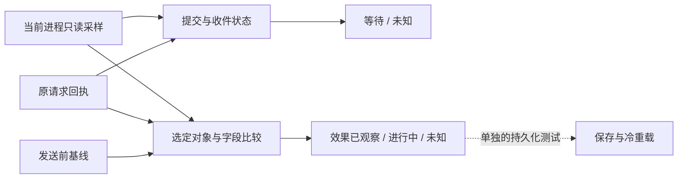

2026-10-16 暂停前最终验收：[工具目录v8](runtime-capability-map-1375-v8.json)的7入口均已有范围受限的验收，待有效世界入口0。支持继承人双向missing-key与和平v2空目标队列均已完整原始读取独审并获root接受；阳性任务/议和body仍未实机验证。当前缺席不回填原请求效果；保存重载只用于另验持久化。用户已要求暂停逆向并整理上传，以下为历史时点。

2026-10-16 最新：议和v2空目标队列完整独审通过；支持继承人FRA-POL当前双向140索引missing-key两样本读取也成功，共享2990/55844B，entry8192只是独立源码声明非journal，阳性body未读。Support完整raw审进行中，目录仍为[工具表v7](runtime-capability-map-1375-v7.json)的6已验/1待验。当前缺席不回填原请求或最终heir效果；不需前台/保存重进。

2026-10-16 当前验收：议和v2空目标队列的唯一实采及2967条原始读数已完整独审通过，详见[工具表v7](runtime-capability-map-1375-v7.json)。已验入口6/待有效对局入口1；非空议和记录仍只有离线覆盖，当前absence不能回填原请求效果。支持继承人新controller的4新增边界case通过，交叉源码审进行中，无新query。下方为历史时点。

2026-10-16 增量：v2真实只读读取已成功，法国1445-05-19暂停时FRA→ENG选定议和收件队列在两次样本中均absent。新增文本配置适配修复已完成8个首次测试与完整源码复核；原R1零RPM失败冻结。唯一R2采样2967RPM/77718B，原始capture/IO完整独审正在进行；当前absence不能回填原请求效果，OS close/fullIO/atomic/lease仍未知。见HANDOFF顶部和work/reports/peace-current-pending-v2-live-controller-20261016-r2/，不重复查询或重载。

2026-10-16 更新：游戏已自主重开、处理成就提示并载入暂停。重开后只读unknown已完整独审，阻塞来自233e064旧值限制，字段语义仍未知。独立v2保留raw与两次一致性；6个新fake、增量check及首次catalog通过，原预算失败保留，完整源审/生产门禁仍进行中，尚未实机运行v2。R83缓存结构桥与四源字段搜索已完整独审，均不升级类型、原请求或效果证明。48/44/42及禁重发保持；下方旧状态为历史，详情见HANDOFF顶部。

2026-10-16 最新：[离线API查找v6](../work/candidates/war-peace-api-lookup-1375-v6/REVIEW_STATUS.md)已通过完整非作者审查，60条证据记录/94固定JSON/346引用，四项首次查询通过，原v5引擎不改。[工具选择表v6](runtime-capability-map-1375-v6.json)仅更新这一项。游戏已按用户要求自主重开、处理成就提示并载入France1445-05-19暂停；新只读查询通过宿主校验，但在233e064读值1与预期-1的校验处返回unknown，尚未采样队列。错误标签“Unsupported current Mod”不证明字段含义或安装Mod，正进行文件证据诊断。未新增外交请求或效果。下方旧版本/主菜单/pending状态保留为历史。

# EU4 1.37.5 实时逆向观察工具

[R78固定六字节样本](../work/reports/server-expected-owner-sample-data-20261016-r78/DATA_REVIEW_STATUS.md)已完整独审：targeted内容为desert，样本内无NUL。它不证明完整字符串、消费长度、类或模式，不改变宿主守卫或读取器实机验收状态。

2026-10-16：[当前虚表引用](../work/reports/server-vtable-current-reference-owner-20261016-r2/ACTUAL_REVIEW_STATUS.md)、[预期虚表引用](../work/reports/server-expected-vtable-reference-owner-20261016-r1/ACTUAL_REVIEW_STATUS.md)和[R74固定资源名数据](../work/reports/server-current-label-data-20261016-r1/DATA_REVIEW_STATUS.md)已完整独审。已确认两处条件对象写入，尚不能证明类、模式或 game+1e00 关联；interface/frontend.gui 只是固定22B文字。现有宿主守卫保持，首次和平队列 status 在宿主守卫处返回unknown，后续静态工作继续。

当前统一入口是 `tools/eu4_observer.py`。它直接读取已绑定游戏进程的内存，将原生请求回执、发送前基线、收件请求和实际效果分开报告，并提供当前联盟、联姻、保障和战争状态。即时效果验收无需保存或重新进入游戏。保存、冷重载另用于验证持久化，不用来替代运行时状态。

[机器可读工具目录第五版](runtime-capability-map-1375-v5.json)列出5个已验收入口，以及2个源码/生产审查通过但待有效世界实测的读取器（支持继承人、当前和平队列）。它分别标明精确入口与清单hash、查询范围和限制；原v1/v2/v3/v4目录冻结。目录只用于工具发现，不认证当前游戏，也不替代各入口的source/runtime guards。15原请求效果、当前状态和纯文件API查找分别列出，不相加为效果覆盖。

下方验收记录中的80340是已经退出的历史进程；运行示例前，先取得当前真实PID/creation。以下PowerShell只读取进程身份，各观察器仍会核对EXE、加载世界与手动暂停状态；无需切换前台。

```powershell
$eu4Candidates = @(Get-Process -Name eu4 -ErrorAction Stop)
if ($eu4Candidates.Count -ne 1) { throw "请选择唯一的 EU4 进程" }
$eu4ProcessId = $eu4Candidates[0].Id
$eu4Creation = $eu4Candidates[0].StartTime.ToFileTimeUtc().ToString('x16')
```

支持继承人的[当前任务读取器](../work/candidates/support-heir-current-observer-1375-v1/STATUS.md)已完成15个首次离线方法、两个独立新边界、源码／生产审查和两个真实失败路径审查。原测试进程退出、新进程世界根指针为空时均保持unknown，没有生成任务结果。有效游戏世界中的任务存在／缺席样本仍待验证；它暂不计入已验收入口或原请求效果覆盖。无需为它保存重进或保持游戏前台。

新增[当前和平队列读取器](../work/candidates/peace-current-pending-observer-1375-v1/REVIEW_STATUS.md)已通过31项新增离线测试、独立源码审查、生产配置审查与首次文件check，首次真实查询在宿主类型守卫处返回unknown、未进入暂停及队列采样；[59pin独立重放](../work/reports/peace-current-pending-observer-live-independent-20261016-r1/findings.json)已通过，队列兼容仍待有效样本。它读取 actor→target 的目标国收件队列，返回 selected_peace_queue_present、selected_peace_queue_absent 或 unknown，并保留原始ID和状态。队列存在/消失不表示原请求接受、拒绝或和平完成。无需游戏前台，也无需保存重载。

```powershell
python -B work/candidates/peace-current-pending-observer-1375-v1/peace_current_pending.py check
python -B work/candidates/peace-current-pending-observer-1375-v1/peace_current_pending.py status --pid $eu4ProcessId --creation $eu4Creation --actor FRA --target ENG
```

新增独立[联统整合当前任务 CLI](../work/candidates/integration-task-observer-1375-v1/STATUS.md)直接报告选定任务存在、选定索引缺席或unknown。它核对不同于吞并任务的虚表、双向索引、完整端点及实际加载的代码；FRA→ORL/DAN→NOR两次真实查询均读到当前索引缺席，35pin原始读取独审通过。24个新离线方法及独立1个反例通过。任务存在只表示当前匹配的任务，缺席也不证明取消；整合最终完成及某次请求效果仍需独立判据，稳定15请求profile不变。

```powershell
python -B work/candidates/integration-task-observer-1375-v1/integration_task_observer.py status --pid $eu4ProcessId --creation $eu4Creation --actor DAN --target NOR
```

宣战与议和的已有逆向结果可用[离线合同查找工具第五版](../work/candidates/war-peace-api-lookup-1375-v5/REVIEW_STATUS.md)检索，支持59项、74个固定JSON来源，原58项及59sources不变；144flat来源、264指针、引擎唯一64→96扩容和保留的4次首次查询已完整独审。R71/R73是条件片段，不能独立调用。原三fixture批次仍失败，两个拒绝只有source/traceback限定见证；独立aggregate首测是虚拟buffer计账。此工具不访问当前进程、不发送请求，执行器尚未完成。

新增独立[关联停战条件投影 CLI 第二版](../work/candidates/linked-truce-projection-1375-v2/STATUS.md)支持四条限定正常路径。原v1实测FRA→ENG/FRA→ORL两路径false，POR→ORL因非空header为unknown；第二版解析header61非零后，对POR→ORL一次新只读查询得到限定false，63pin独立原始读取重放通过，旧unknown保留。新增12个delta方法及首次check/catalog通过；未调用游戏函数、保存或重载。它仍不是完整停战或议和效果验证器，未改下方稳定15/98pin入口。

```powershell
python -B work/candidates/linked-truce-projection-1375-v2/linked_truce_projection.py status --pid $eu4ProcessId --creation $eu4Creation --actor POR --target ORL
```

另有独立[当前方向性停战缓存CLI](../work/candidates/direct-truce-cache-cli-1375-v1/STATUS.md)，支持check/catalog/status。它读取原生消费者使用的pair+45 mask1，提供完整身份、国家指针表及原始关系记录；没有接入稳定98pin入口。源码、封存清单和真实四方向查询均经独立审查。false和true都可以表示读取成功，不能据此判断完整停战、期限或议和效果。

```powershell
python -B work/candidates/direct-truce-cache-cli-1375-v1/direct_truce_cache.py check
python -B work/candidates/direct-truce-cache-cli-1375-v1/direct_truce_cache.py status --pid $eu4ProcessId --creation $eu4Creation --actor FRA --target AUV
```

FRA↔AUV、POR↔BRI四次真实读均返回缓存false，独立[实采文件审计](../work/reports/direct-truce-cache-cli-live-review-20261015-r1/independent-live-review.json)通过51pin；没有为取得阳性修改关系或重发动作。observe阶段约5.65–5.83秒，不含之前的Libraries初始化；Job CLI完整范围约7.78–7.91秒。源自冻结host的入口8192B PE检查另计，不能把选定BudgetReader数字当全部OS读取量。普通采样结束调用Held.close并清本地handle，OS关闭返回值未检查。

工具只使用已有 held-process QUERY/VM_READ 通道；不会注入 DLL、调用游戏函数、写游戏内存、发布外交请求或自动重发。请求效果查询需要真实安装会话回执；关系和战争当前状态查询可以在没有研究 DLL 的游戏进程中使用。只读采样的随机 nonce 不是安装会话。知识、关系和战争采样要求测试局手动暂停；内存读取无需游戏保持前台。

判断一次操作时，先读取原请求的原生回执，再对比发送前基线与当前选定对象。回执中的“已派发”只说明提交到了发送链；收件请求仍在时报告等待；选定关系或任务发生变化时才报告对应效果。吞并任务存在表示进行中，知识分享任务存在也不表示机构已经接纳。缺少基线、进程身份变化、双遍不一致或布局不支持时报告unknown，不据此重发。



保存和冷重载用于验证已经观察到的效果能否持久保存；不再作为逐次判断操作完成的前置步骤。当前战争端点回答双方是否仍交战，议和条款结算及特定请求完成仍需独立证据。

## 查询入口

在项目根目录运行；下列会话文件、请求 ID 必须取自已有的真实请求记录，不自行编造。

```powershell
python -B tools/eu4_observer.py catalog
python -B tools/eu4_observer.py effects --session-file SESSION.json --allow-tag-host status --request-id ORIGINAL-ID --compact
python -B tools/eu4_observer.py effects --session-file SESSION.json --allow-tag-host watch --request-id ORIGINAL-ID --compact
python -B tools/eu4_observer.py relations --pid $eu4ProcessId --creation $eu4Creation status --action guarantee --actor SAV --target FRA
python -B tools/eu4_observer.py war --pid $eu4ProcessId --creation $eu4Creation status --actor ENG --target AMG
```

`catalog`只查文件。`effects`复用冻结的 `observe_diplomacy_live.py`，支持 catalog / prepare / status / watch / serve。prepare 只创建本地、不可覆盖的发送前基线，不授予重测许可，也不发布请求。观察器不会替代项目的跨会话审计、test-only 或禁重发策略。

效果查询退出0表示选定效果已观察，3表示已证明等待收件人，2表示效果未出现或证据不足，须读取JSON区别。吞并任务出现只表示 `in_progress`，不能当吞并完成。关系或战争查询退出0表示当前状态已读出；存在、反向关系和缺席都可能返回0，不能将退出码当外交操作成功。

保障查询必须看status与`requested_direction_matches`：SAV→FRA当前返回`reverse_relation_observed/false`，表示当前是FRA保障SAV。底层`current_relation_observed`表示同pair的索引关系存在，不能单独用它判定请求方向。联盟、王室联姻按无序双方匹配。

## 本地 HTTP

统一服务由同一入口的 `serve` 启动。令牌从 `EU4_OBSERVER_TOKEN` 环境变量读取，须为16–256个ASCII字符。需要请求效果路由时提供真实 `--session-file`；只提供 `--pid/--creation` 时，开放当前关系和战争查询，capabilities 的 effects profiles 为空，effects 路由返回404。服务只绑定127.0.0.1。

| 方法与路径 | 返回内容 |
| --- | --- |
| `GET /observer/v1/capabilities` | 当前会话实际可用能力、来源身份及限制 |
| `GET /observer/v1/effects/<original-request-id>` | 原请求的回执、回复与选定效果 |
| `GET /observer/v1/relations/<action>/<actor>/<target>` | 当前联盟/联姻/保障，明确保障方向 |
| `GET /observer/v1/wars/<actor>/<target>` | 当前交战关系、双方完整成员与索引 |

请求须带 `Authorization: Bearer …`。拒绝外部Host、Origin、重复认证头和写入方法；没有 publisher 路由。完整采样可留本地journal，HTTP只返回选定内容。读取或参数拒绝的409/422明确带`status=unknown`、禁止自动重发，不能当成游戏原生拒绝。测试服务已关闭，交付时没有后台监听器；最终入口也在启动输出失败、服务异常或中断时关闭listener。

## 当前覆盖和判定

新增独立候选[关系原请求CLI](../work/candidates/relation-request-observer-20261015/relation_request_cli.py)已封存125个source pin，目录含原15加offer_alliance、royal_marriage、guarantee，共18请求profile。它将真实安装会话、原请求完整回执、发送前absence基线与发送后双typed索引关联；catalog18不代表18次实机效果通过。候选check/catalog与拒绝将只读nonce当安装会话的实际文件检查、独立边界及封存审计通过，尚未接入稳定入口，也没有新关系派发/实机效果。候选有自己的CLI与manifest，使用和限制见[CLI说明](../work/candidates/relation-request-observer-20261015/CLI.md)；稳定入口仍是下述15个profile。

当前15个请求效果profile：吞并启动、取消吞并、退出包围网、请求/设立/撤销卫戍国、释放索尤尔加尔、解除贸易保护国、人情换信任/金币/兵源/水手/备战，以及提供/请求知识分享。另有3个当前关系reader：offer_alliance、royal_marriage、guarantee。当前关系不替代新请求的baseline和回执；原120绑定的全部效果profile尚未完成。

[观察覆盖与缺口清单](../work/reports/diplomacy-observer-gap-map-20261015-r1/report.md)另列42项修复候选：其中两项知识分享已有reader，其余40项尚未进入稳定或候选请求效果目录，分为继承、联统整合、联盟／联邦、隐蔽活动、朝贡和脚本复合效果六类。48选定效果、44持久化和42修复候选是当前保留覆盖数字，不是120项全部通过。该盘点说明数字重建依据；44持久化沿用历史总数，本次没有重新核验全部历史闭包。

知识分享新版核对typed对象、完整提供国/接受国、双向typed索引与容量、提供国的全局bucket、有效期限和移除状态。只有同一真实请求的完整派发回执，以及发送前精确pair不存在、发送后精确活动对象出现，才能标记新活动分享效果。任务总数增加不构成证明；活动分享不表示机构已拥抱。

战争新版核对全部当前全局战争、双方关系索引、完整国家句柄和完整成员。R7旧版将relation record+46 bit4误当持久交战标志；原生消费者 `a68a00` 与实机反例证明该假设不成立，独立R7-r2已修正，旧版本和反例保留。当前战争消失不能证明议和条款生效、对象已析构或请求因果关系。

身份、加载状态、来源pin、类型、容量、端点或双遍一致性检查失败时保留unknown，不将未知转换成拒绝或成功。两次相同外部读取仍不是原子世界快照，不能证明world epoch或借用对象的原生调用期存活。宣战、议和执行器仍未开放。

## 实际验收

- 最新固定80340保障CLI再次双遍读出FRA保障SAV；以SAV→FRA查询报告reverse_relation_observed/false，采样1156.004ms，没有保存、重载或动作派发。[当前读取回执](../work/reports/war-peace-api-20261015-r12-readonly-preflight/receipt.json)。这是当前状态，不是新增API效果。

- 原奥尔良→法国请求55：正常UI接受原请求一次，实时观察到vassal→march；效果验证窗口内没有保存、重载或重发。[实机回执](../work/reports/diplomacy-reply-observer-20261015/live-verification.json)。
- PID80340：提供知识分享FRA→JOL和请求知识分享MAL→FRA均严格读到当前pair不存在，145.127/148.836ms。仅验证decoder和当前absence，没有派发或活动效果测试。[独立审计](../work/reports/diplomacy-live-observer-20261015-r1/independent-live-decoder-file-audit.md)。
- PID80340：随后直接读到MOS→NOG、YAS→TIM（provider为TIM）及MNG→SYG三个现存活动分享任务，174.799/157.298/155.118ms，双typed索引/global/完整对象头一致。仅证明现存活动任务，不计为新API效果通过或机构完成。[正反decoder审计](../work/reports/diplomacy-live-observer-20261015-r1/independent-existing-sharing-file-audit.md)。
- PID80340 HTTP：ENG→AMG当前交战、FRA→ENG当前非对手，847.451/837.940ms；鉴权失败403、写入405、未配置effects404；监听器关闭、线程回收。[实机回执](../work/reports/runtime-observer-20261015-r1/live-http-verification.json)、[独立审计](../work/reports/runtime-observer-20261015-r1/independent-file-audit.md)。时间为各报告定义的采集范围，不能统一宣称低于100ms。
- 新统一外交层34项组合/guard/loopback测试、战争host19项测试及统一入口6项校验回归测试通过；战争reader另有33项纯测试。R1/R2原有121项保留，不将来源pin数或重复运行次数算测试数。
- 新增关系reader37项、关系host30项、R3组合13项和最终入口清理6项测试通过。真实组合HTTP共13案例：6关系、2战争及capabilities/403/405/404/422；8完整capture与compact独立审计一致。[实机回执](../work/reports/runtime-observer-20261015-r3/live-http-verification.json)、[独立审计](../work/reports/runtime-observer-20261015-r3/independent-live-http-file-audit.md)。关系host采集约1.14–1.21秒，战争约0.93–0.95秒；未记录完整HTTP RTT，纯reader约1ms不能充作接口总耗时。
- 最终public入口98个来源pin通过，catalog/effects catalog/relations check/war check均exit0；SAV→FRA保障真实CLI返回reverse/false。[入口验收](../work/reports/runtime-observer-20261015-r3/public-entry-verification.json)。

最终入口manifest：[eu4_observer_manifest_1375.json](../bridge/eu4_observer_manifest_1375.json)，SHA256 `23c6831a861425c5f3012b583c93c6c1ccf7d10c769f9a23389474d389c9b361`。入口首条操作校验自身和冻结依赖，组合HTTP在delegated读取前后核来源。初版提前转发的P2、R3启动打印清理的P3及旧源码/manifest/证据全部保留；最终入口清理回归通过。实机HTTP调用冻结R3.compose_server，真实public CLI另行验证，不混称启动过外部public HTTP进程。

另有独立实验室[原生入口采样工具](../work/reports/war-peace-api-20261015-r12-entry-live/report.md)，通过短暂Frida代码hook取得真实Q/线程/调用链，随后独立检查入口字节恢复。它已完成固定80340一次实采与239pin独立审计。后续独立[R19 body-only测试](../work/reports/war-peace-api-20261015-r19-body-live/report.md)在自有raw buffers上调用500560一次并正常返回，前后字节及255local/11external审计通过；该实验含native调用和owned写，不能混为稳定只读工具。两项均不发送外交动作，nativeReady/lease仍false。效果查询的稳定入口继续使用QUERY/VM_READ。入口与函数体测试帮助逆向ABI和对象关系，不能代替原请求baseline/回执或证明宣战、议和条款结算。
