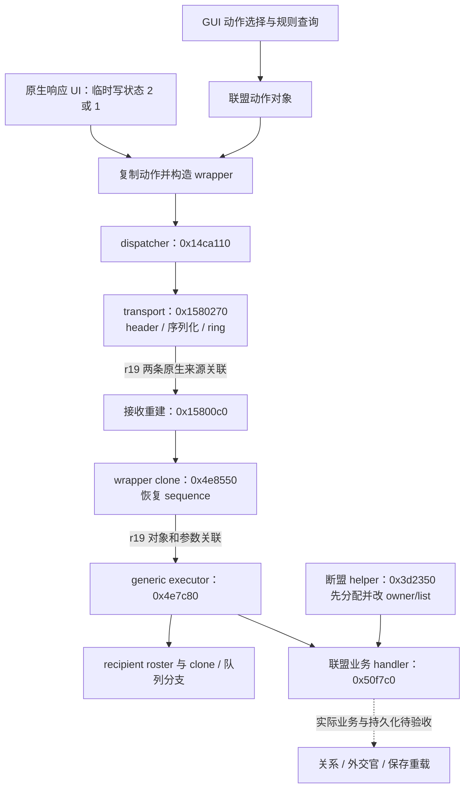

# 联盟外交逆向梳理

更新：2026-10-14。模块入口：[reverse_engineering](../reverse_engineering/README.md)；机器可查询索引：[alliance.json](../reverse_engineering/data/alliance.json)。

## 1. 这次梳理要解决什么

当前目标是把联盟做成完整的原生外交接口示例：查询原生规则、隔离受控国家的自主决策、正常构造和提交请求、处理双方响应、核实外交官与关系变化，并验证保存重载。最新运行层为 **r19 查询和发送来源观察**；r17c、r18 记录保留为历史证据。

**r19 的新结果：** transport 与包装读取观察点在同一次原生投递中记录发送对象、重建对象及接收 peer。独立验收器随后把重建对象关联到接收复制品和执行入口，得到两条完整来源关联，完整 header、九项 payload、peer/ring/owner 和 callback 顺序均通过。见 [r19 来源验收](../work/runtime/alliance-query-20261014-r19/lifecycle-observation-cc9c84d97c4d414192552215662090de/transport-validation-001.md)。该结果补齐了此前发送到重建的关联证据；下一步是让实际桥接请求沿相同路径携带授权并记录原生回应。

本轮建立链路地图和证据索引，实际执行适配的完成标准仍以[外交接口开发方案](外交接口开发方案.md)和[外交能力矩阵](外交能力矩阵.md)为准。下表中的“已确认”只覆盖对应列出的结论。

索引包含 42 个节点、29 条关系和 8 个优先问题，分别记录静态事实、归档运行观察、设计 fixture 和缺口。REA 默认分析的两次尝试超时后，项目按需入口已取得接收重建函数的成功反编译和汇编 Evidence；范围与清理记录见第 7 节。

| 层次 | 当前可依赖的结论 | 仍缺什么 |
|---|---|---|
| 查询 | 八组联盟查询、九项 guard 已归档通过；发起层原生 selector、可见性、validity 与部分接受预测可读取 | 理由原生标识/尺度、完整费用与参数成本、运行状态变化后的复查 |
| 请求与包装 | 联盟动作和 wrapper 的虚表、字段、复制、序列化与本地队列写入有静态证据 | 桥接正常构造、发送 owner 的身份及权限、独立发送回执 |
| 接收重建 | r17c 两条 CAS→POR 局部样本，clone 返回 wrapper/action/完整 payload 与后续执行入口连续；sequence 被恢复 | 发送→接收因果链、来源命名空间、授权移交、对象代际 |
| 执行与响应 | generic executor、recipient 路由、联盟业务分支及断盟旁路有静态地图 | 受控国隔离、真实授权提交、实际接受/拒绝及业务后果 |
| 生命周期与持久化 | 析构/clone 观察和独立授权 ledger fixture 已归档；基础保存工具有历史验收 | 原生 allocator 与 owner 关联、业务关系及外交官后果的保存重载 |

查询通过、预测接受、进入队列、到达执行入口和真实业务成功应分别登记。

## 2. 二进制与证据身份

| 项目 | 绑定值 |
|---|---|
| 游戏 | EU4 1.37.4，x64 PE，`eu4.exe` |
| EXE SHA-256 | `b23fa0e1f698d31b01cdd1c3817a675805d8c6286cb66f9c231e6e2a42544d77` |
| 静态 image base | `0x140000000` |
| r17c 归档 session | `60892-1dd5b1d26b30a9b` |
| r17c DLL SHA-256 | `e4c14dadfcfe13f967e3d6ca220b0a81e27680af15cad221f1055cd3c8256c87` |
| REA / Ghidra / JDK | REA 6.4.0 / Ghidra 12.1.4 / Temurin JDK 21.0.12.1 |

本轮已重新读取 EXE 并核对 SHA-256。表内 session 和 PID 是归档身份，不能用于选择当前进程。所有下文地址均为 **RVA**，除非明确写成 VA；静态 VA = `0x140000000 + RVA`，运行时 VA = 当次模块基址 + RVA。字段偏移、selector、discriminator 和 action id 不是 RVA。

证据等级：`runtime_observed` 是指定实验的运行观察，`static_observed` 是当前 EXE 的机器级事实，`inferred` 是待验证解释，`unknown` 是缺口，`fixture_verified` 是独立测试性质。反编译结果属于静态分析，无法自行证明线程、外部调用 ABI、授权来源或业务执行。

## 3. 链路地图

下图是已有路径和缺口的地图。实线表示有静态数据流依据的连接；虚线明确标出尚未建立的因果或业务连接。它不表示一次请求已完整经过所有节点。



dispatcher 到具体 transport 的绑定结合静态调用和归档的 `transport-owner-live.json`；该报告只证明当时对象与槽位，不能充当桥接发送成功。generic executor 到业务 handler 的连接应按动作虚表和原生状态路径阅读，不能把不同路径合并成一次运行链。

### 3.1 查询和发起层

| 函数/位置 | RVA 或槽位 | 已确认用途与限制 |
|---|---|---|
| 外交列表填充 | `0xf0bc30` | 向列表构建器提供两端点 |
| 列表构建器 | `0x35c260` | 联盟 action id `0x293d`，分别取 variant 1/0 |
| 可见性 selector | `0x35a920` | 原生 UI 选择与可见性路径 |
| 动作构造 | `0x35a8b0`、`0x50f780` | 普通联盟对象字段初始化；构造不等于提交 |
| 动作虚表 | `0x1c80720` | `+0x80 → 0x511d90` validity，`+0x90 → 0x512a00` 发起 gate |
| 当前接受检查 | `+0xb8 → 0x4ea210` | 按动作及调用阶段解释；运行预测不等于实际回应 |
| 理由向量 | `+0x120 → 0x513120` | 原生理由读取路径，行布局另有静态记录 |

发起对象 `variant +0x38=1` 对应 Offer/New Alliance，`0` 对应 Break/Cancel。通用目录中的中文“断盟”是接口名称，不能把目录名字当作原生枚举名。

来源：[GUI 规则覆盖](../work/runtime/alliance-static-20261013/gui-alliance-rule-coverage-20261013.md)、[动作审计](../work/runtime/alliance-static-20261013/alliance-static-audit.md)、[理由布局](../work/runtime/alliance-static-20261013/reason-layout-static-summary.md)、[r17c 查询验收](../work/runtime/validation-alliance-20261013T141723Z-2c9ee9dfd801/validation-report.json)。

### 3.2 响应构造、移交、序列化和本地队列

| 函数/位置 | RVA | 已确认用途与限制 |
|---|---|---|
| 请求 UI 构造 | `0x1067840` | 通过动作 clone 把复制品保存在 `this+0x238` |
| 响应状态 2 / 1 处理器 | `0x10668e0` / `0x1066a20` | 临时修改动作状态，复制入 wrapper，再恢复原 UI 动作状态 |
| action clone | `0x513090` | 复制参与端点与状态等字段 |
| wrapper 构造 | `0x4e9960` | 生成 `0x58` 字节 wrapper，`+0x50` 持有复制动作 |
| 原生响应 delivery | `0xbfe50` | 从 server `+0x80` 取得 context，移交 wrapper out-pointer，必要时清理残留对象 |
| dispatcher | `0x14ca110` | 从 out-pointer 取 wrapper 并清空原指针，经 context 的 transport 槽移交 |
| transport 槽 `+0x30` | `0x1580270` | 改写 header、序列化、native ring enqueue；没有独立网络/服务器 receipt |
| outer / payload serializer | `0xd2f280` / `0x4e8470` | 保留序列化开始与完整 header/payload 的观测边界 |

UI 原对象、action clone、wrapper 是不同对象。UI 的临时状态恢复，不能被误读为请求撤回；复制品中的状态会继续随包装传播。listener 的 `vtable+0x80` 返回 context，再进入 dispatcher；这里的 `+0x80` 是 **虚表槽偏移**，不等同于任意对象字段 `context+0x80`。

来源：[UI 响应数据流](../work/runtime/alliance-static-20261013/response-chain-native-summary-20261013.md)、[transport 协议](../work/runtime/alliance-static-20261013/transport-protocol-report-20261013.md)、[归档 transport owner](../work/runtime/alliance-query-20261013-r12/transport-owner-live.json)。

### 3.3 接收重建和 sequence 连续性

接收重建的 PE unwind 范围为 `[0x15800c0, 0x158026e)`。更精确的数据流是：接收对象 `+0x118` 指向队列结构候选；`0x1580173` 调用 `0x1581120`，将取出的 source wrapper 写到当前栈的 `+0x60`，`0x158018a` 再读出该包装。随后通过 wrapper `vtable+0x60 → 0x4e8550` 克隆，并在 `0x15801e8` 将 source `+0x4c` 的 sequence 写入 target `+0x4c`。target 挂入接收列表，source 随后析构。列表写入目前只有静态证据。

2026-10-14 的有界 REA Evidence 补足了旧接收合同对 `+0x118` 的简写：它不是直接保存 source wrapper 的字段。此修正由汇编的出参和栈数据流支持；队列的原生类型和完整来源仍未恢复。旧报告保留原貌。

r17c 记录了 675 次 wrapper field begin、20 次联盟 wrapper clone、2 次 serialization_begin 和2次 command entry。20 次 clone 的调用者返回地址均为 `0x15801e2`；clone 返回快照是 `origin=65535 / flags=0 / sequence=0`。两条 CAS→POR 局部样本保留返回 wrapper 地址、action 地址和九项 payload，后续入口的 sequence 恢复为源对象的 41 / 747。

因此可以依赖“特定接收重建转换及两条局部对象连续性”；**全阶段链和完整 key 链仍为 0**。sequence 只是完整关联字段之一，不能代替来源、对象代际或授权。`65535` 的 clone 标记不能作为授权通配符。

来源：[接收重建合同](../work/runtime/alliance-static-20261013/incoming-receive-contract-20261013-r17c.md)、[协议连续性](../work/runtime/alliance-query-20261013-r17c/protocol-continuity-core.json)、[修正后的独立验收 002](../work/runtime/alliance-query-20261013-r17c/r17c-protocol-validation-002.md)。

### 3.4 generic executor 与 recipient 路由

response wrapper 的 `vtable+0x48 → 0x4e7c80` 读取 `wrapper+0x50` 的动作，并走原生检查、状态分支、外交官/manager、clone 和后续处理。动作 `+0x80` 有效性调用是其中一环，不能据此认定完整规则、资源分配和权限隔离均已完成。

state-zero 路径先调用 `0x4ea850`，再进入 recipient 路由。该 helper 会修改 global/country 数据，并在端点条件满足时调用动作 `vtable+0x48 → 0x50f7c0`；它不是只读检查。后续响应 clone 被写入状态并构造新 wrapper 后，经 `0xbfe50 → 0x14ca110` 投递。研究时需要分别保留“业务前处理”“响应选择”和“包装投递”的阶段及对象身份。

在 `0x4e8163..0x4e81c5`，代码用 recipient 的有符号国家 slot 查询 `global+0x1d48..+0x1d50` 的 DWORD roster：

| 原始条件 | 机器级目标 | 当前解释 |
|---|---|---|
| roster 数量为 0，或 recipient 条目非零 | `0x4e8235` | clone 写入 recipient 侧容器的候选路径 |
| roster 非空、条目为 0、`0x2cd5a0` 返回 AL=0 | `0x4e8333` | 继续/退出路径 |
| roster 非空、条目为 0、`0x2cd5a0` 返回 AL=1 | `0x4e81c5` | clone 与后续响应选择路径 |

三个目标和条件已有静态证据；roster 的完整业务名称、secondary predicate 的意义以及“受控国/玩家/AI”的对应关系仍未证实。归档样本中的 POR 非零条目是局部观察，不能直接推广为 FRA 的路由依据。

来源：[接收路由分支](../work/runtime/alliance-static-20261013/incoming-authority-route-20261013-r17.md)、[delivery 与业务前处理](../work/runtime/alliance-static-20261013/delivery-decision-flow-20261013.md)、[归档运行路由](../work/runtime/alliance-query-20261013-r17c/route-runtime-new.md)。

### 3.5 接受、拒绝与业务 handler

较新的 `0x50f7c0` 分支与原生消息键审计，补足了较早 UI 报告没有建立的语义：

| 条件 | 静态语义 | 证据边界 |
|---|---|---|
| `variant +0x38=0` | Break/Cancel Alliance 路径 | 初始分支不依赖 state；关系修改仍须实际验证 |
| `variant !=0` 且 `state +0x34=2` | 接受路径 | `MILALLACCEPT` / `MILALLWEACCEPT` 等原生消息键及国家视角 |
| `variant !=0` 且 `state=1` | 拒绝路径 | `MILALLREJECT` / `MILALLWEREJECT` 等原生消息键及国家视角 |
| `variant !=0` 且 state 不是 1/2 | 清理等其他路径 | 不命名为一个全局状态枚举 |

普通 Offer 构造中 `+0x10/+0x18` 是 offeror/actor 句柄及镜像，`+0x20` 是 recipient；消息分支表明 recipient 作响应选择。这个解释限定于该构造形态和业务分支，不能直接用于 DirectBreak helper 或未知的字段复用对象。

接受路径能静态追踪到双方国家对象的调用和 `country+0x401=1` 写入，再进入有副作用的 `0x4ec500`。这证明内存操作，尚未确定每个字段的关系语义，也没有证明磁盘持久化或当前桥接请求的实际接受。

来源：[决策语义分支图](../work/runtime/alliance-static-20261013/decision-semantics-branch-map-20261013.md)。历史 UI 报告的“语义未知”在其单独范围内成立；最新索引按后续更强证据更新，并保留旧记录。

### 3.6 断盟旁路和更早的副作用

`0x3d2350` helper 创建 variant 0 的联盟对象，在 `0x3d24f4` 直接调用 `0x50f7c0`，绕过 generic wrapper 的执行入口。它有七个 engine-side 直接 caller；r18 静态分类记录保留其参数和条件，没有证明每条路径都是原生 AI 主动断盟。

重要的先后关系：`0x3d23c6` 已有分配，`0x3d2406/0x3d2449` 已修改 owner/list/vector，随后才进入 `0x50f7c0`。所以只在业务 handler 阻断，不能保证前置副作用尚未发生；全局阻断共享 helper 又可能影响维护、事件或强制处理路径。需要先确定各 caller 的决策主体与隔离边界。

来源：[入口覆盖缺口](../work/runtime/alliance-static-20261013/authority-entry-coverage.md)、[业务前副作用](../work/runtime/alliance-static-20261013/authority-entry-prebusiness-effects.md)、[r18 caller 来源分类](../work/runtime/alliance-static-20261013/direct-break-source-role-20261013-r18.md)。

## 4. 对象与字段地图

对象名称是分析标签；原生 C++ 类型、布局对齐或外部调用签名没有因此自动恢复。

| 对象 | 关键位置 | 已知关系 | 尚未知 |
|---|---|---|---|
| 联盟动作 | vtable `0x1c80720`；discriminator `0x165` | 普通构造、clone、规则、响应状态和业务分支 | 其他形态的端点方向、完整 ownership / 外部 ABI |
| 联盟 payload | `+0x10/+0x18/+0x20/+0x28/+0x2c/+0x30/+0x34/+0x38/+0x3c` | 九项字段作为完整关联事实保留；`+0x38` 为 variant | 日期转换、外交官字段全部语义、proposal 字段用途 |
| response wrapper | vtable `0x1c814b0`；`+0x50=action` | `+0x48/+0x4a/+0x4c` 分别保留 origin/flags/sequence 原始宽度 | origin 身份命名空间、sender、header 的授权含义 |
| receive 容器 | `+0x118=队列结构指针候选`；source wrapper 由 `0x1581120` 的出参取得；`+0xc8/+0xd0/+0xd8` | source→clone→sequence 恢复→target 列表→source 析构 | 原生队列类型、列表写入的独立观察、完整网络因果与 target 代际 |
| recipient 容器 | country `+0x18d8/+0x18e0/+0x18e8` | 原生 clone 与容器写入候选 | pending/ownership 的完整业务语义及受控国规则 |
| reason row | 48 字节行布局 | 数值、字符串、布尔字段已有有界分析 | 原生标识、尺度、完整性与费用字段 |

原生字段宽度保留在对应 observer/静态来源；授权 ledger 把原始值保存成 canonical words 是其内部表示，不能反推为原生所有字段均为 64 位。

## 5. 生命周期和授权底座

可复用的设计要求是：区分 outgoing、incoming、target 对象身份及代际，精确绑定 payload、phase、header、会话和期限；只沿已确认重建转换移交一次许可；移交后分离 source，析构、撤销、超时和重复消费分别处理。

`alliance-authority-ledger.h` 是不调用游戏函数的设计底座，尚未编入或启用于 r17c。最新 `review-003` fixture 的 163 项检查通过，只证明该底座在独立测试中的性质；生产来源 proof、长期回收、原生 allocator 和真实授权执行仍未实现或未验收。不要用历史的基础 145 项报告替代最新独立复核。

来源：[ledger 源码](../work/native/alliance-authority-ledger.h)、[review-003 验证](../work/runtime/alliance-query-20261013-r17c/authority-ledger-fixture/review-003/verification.json)、[当前交接](../HANDOFF.md)。

## 6. 当前问题与后续顺序

| 优先级 | 问题 | 下一步证据 | 完成标准 |
|---|---|---|---|
| P0 | owner / origin / country handle 的身份命名空间 | 同一归档/新实验中对齐 context、国家表、header 与对象身份 | 能确定谁发起、谁决策、权限事实从哪里取得，而非只比 sequence |
| P0 | recipient roster 的受控国路由 | 复核多个已知国家的条目、secondary predicate 与目标分支 | 分清 native response、受控接收队列及第三方行为，原生前置规则保持有效 |
| P0 | `selector 0x240` 的含义 | 有界追踪 UI callsite `0x828f96`、helper callsite `0x1066849` 及其对象 | 确认实参、类型、调用者和阶段；不同命名空间的同值不能直接连边 |
| P1 | 正常 sender 与接收因果链 | 完整 header/payload、source/target 代际、dispatcher/transport 独立边界 | 补齐发送 receipt，逐阶段连接同一个 intent |
| P1 | 七个 DirectBreak caller 的分类 | caller 前置 owner/条件、allocator、容器写入与运行来源 | 找到足够早且语义完整的隔离边界，区分自主决策和必要维护 |
| P1 | 原生 allocator 与所有权 | 有界分配/复制/析构关系及被动对象代际 | 防止地址复用、source 析构或包装变化错误继承授权 |
| P2 | 实际 accept/reject、外交官和关系后果 | 正常授权执行后的响应、状态变化与双向参与者证据 | 接受/拒绝区别于预测，费用、任务、归途和关系结果可核对 |
| P2 | 完整业务保存重载 | 前后存档及新进程重载对照 | 关系和资源后果持久化，既有查询/控制保存证明保持独立 |

先补 P0 的身份和路由，再接正常 sender 与最早隔离边界，最后完成单次 intent 的真实响应、后果和保存重载。遇到新函数时按这张问题表展开；既有函数、布局和证据优先复用。

r18 `wrapper-sender-field-*` 文件提供了字段/输出 helper 的静态线索，文件名中的 sender 是研究假设。当前没有证据将这些 helper 命名为实际发送器或把相同 selector 数值归入同一命名空间。

## 7. 本轮 REA 分析与资源记录

首次 MCP `analyze_function(0x1415800c0)` 使用 512 MiB Java 堆，在默认 330 秒首次导入时限触发 `provider_timeout`。没有产生该函数的成功 Evidence；这次失败不能当作函数行为证据。监测峰值约 783.6 MiB committed memory，未触及 1 GiB 上限；随后已关闭该会话并核对其 Java 进程结束。

本轮另用已安装的 REA 官方 CLI，将单次首次导入时限改为 900 秒、保留 512 MiB 堆和实际 committed-memory 监测。该次查询仍返回 `provider_timeout`，总耗时 904.34 秒，峰值 826.7 MiB committed memory，未获得成功 Evidence。两次分析的 JVM 和 CLI 进程均已结束，MCP 会话已关闭；没有超过内存上限或留下分析进程。

这两次历史失败的状态、完整错误输出和清理结果记录在索引 `analysis_runs`、[本地最终记录](../work/runtime/rea-alliance-20261014/final-analysis-status.json)及同目录的 `retry-run.json` / `memory-report.json`，保留为失败记录。

后续诊断确认 REA 6.4.0 在默认全 EXE 自动分析结束后才启动 bridge。原版 REA 的小型 PE 查询成功；EU4 的 60 秒分析预算实验中，入口反汇编耗时 58.933 秒。详见[REA 故障诊断与按需分析](REA故障诊断与按需分析.md)。

项目专用 `reverse_engineering.rea` 入口跳过全程序分析，以精确 EXE 哈希和 PE unwind 范围绑定已声明函数。在同时声明 receive / wrapper clone 的实验中，receive 查询耗时 38.14 秒，Java committed-memory 峰值 736.9 MiB，返回 430 字节 body、112 条汇编、19 个基本块及伪代码。Evidence ID：`ev_6062bf4522b8b95a026fe3359d8b9d87ea83a1bacab95e31cc4b7f221770f61b`；[原始结果](../work/runtime/rea-diagnostics-20261014/seeded-receive-v3/evidence.json)、[运行记录](../work/runtime/rea-diagnostics-20261014/seeded-receive-v3/run.json)。实际查询函数只有 receive；声明 clone 不等于已获得 clone 的反编译结果。

此 profile 为 `eu4-declared-seeds-pdata-noanalysis-v2`，承诺适配器、helper 和范围 SHA。默认 MCP 行为未改变；全局交叉引用、未声明函数范围和类型分析仍不完整。PE unwind 范围不证明全部语义函数片段或外部 ABI。进程已清理，新结果只增强静态证据，不新增游戏业务验收。

索引工具不自动导入整个 EXE。新的原生查询按函数和问题展开；原始 Evidence 保留本机，后续优先复用相同哈希和配置的已完成分析。

### 7.1 后续完整库与缓存查询

默认全程序静态分析已在 3426.28 秒内完成并保存：65,423 个函数、6,662,700 条指令，Java 峰值 814.9 MiB。完整库已通过报告、EXE 哈希、保存日志和进程清理检查，并发布到 `work/runtime/ghidra-full/latest.json`。现在 `python -m reverse_engineering.rea` 默认复用完整库；`--seeded` 选择上面的旧有界流程。

连续查询 receive / wrapper clone 分别用时 30.80 / 26.41 秒，返回 112 / 65 条汇编及伪代码。两次 profile 均为 `eu4-persistent-default-analysis-v1`，数据库哈希前后不变，无重新导入和默认分析阶段。完整结果与使用方式见[完整分析与缓存查询](Ghidra完整分析与缓存查询.md)。完整静态库不等于全部游戏语义已恢复，也不增加 r17c 的业务运行验收；间接调用、类型和授权边界仍按第 6 节补证。

## 8. 如何查用与维护

```powershell
python -m reverse_engineering overview
python -m reverse_engineering symbols receive
python -m reverse_engineering symbols 0x15800c0
python -m reverse_engineering questions
python -m reverse_engineering validate --check-sources
```

每条节点、边和问题都指向 `sources` 中的项目相对路径与行号。原始证据属于本机 `work/runtime/`，源码副本缺少它们时 `--check-sources` 会报告缺失，而不会默认为已验证。

新增结论时分别更新节点、关系或对象字段的状态和限制；记录 EXE 哈希、分析 profile、Evidence ID 或具体实验身份。较新证据推翻或补足旧结论时写明原因，保留历史范围。本模块的索引通过不等于 DLL 可调用、权限已开启或外交业务已验收。
